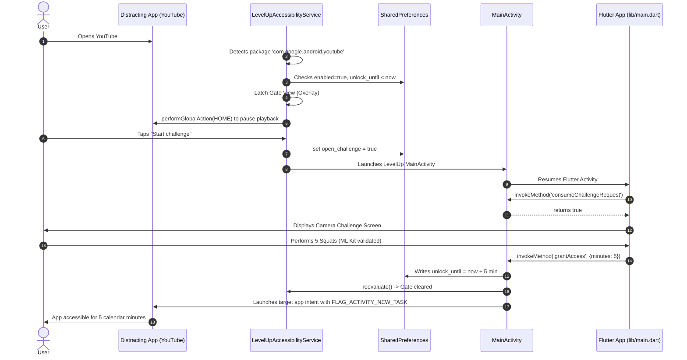

# LevelUp — System Architecture

**Product:** LevelUp (Android SportTech)  
**Vision:** Less Scrolling. More Living.  
**Version:** 4.0 Architecture Specification  
**Source of Truth:** [README.md](../README.md)

---

## 1. Executive Summary

LevelUp is an Android SportTech application that helps users voluntarily curb distracting screen time (such as TikTok, Instagram, and YouTube) by replacing friction with physical movement (e.g. 5 squats detected via Google ML Kit to unlock 5 minutes of screen time).

The application is built using a hybrid **Flutter (Dart) + Android (Kotlin)** architecture:
- **Flutter** delivers the user interface, design system, camera preview, and ML Kit pose analysis.
- **Kotlin** operates the low-level Android `AccessibilityService` (Blocker v3) to detect targeted app launches, display a latched gate overlay, and manage voluntary app gating.

---

## 2. Current Prototype Architecture (Blocker v3)

The existing prototype is validated on Google Pixel (Pixel 7 Pro, Android 16 / compileSdk 36) and consists of the following components:

```mermaid
flowchart TD
    subgraph Flutter_Layer["Flutter / Dart Layer (lib/main.dart)"]
        UI["UI Screens (HomeScreen, ChallengeScreen)"]
        Cam["Camera Preview (camera + camera_android)"]
        ML["Pose Detection (google_mlkit_pose_detection)"]
        SquatLogic["Squat State Machine (Knee Angle <125° / >155°)"]
        MethodChannelDart["MethodChannel('levelup_test/control')"]
    end

    subgraph Native_Layer["Android Native Layer (Kotlin)"]
        MainActivity["MainActivity.kt (FlutterActivity)"]
        Prefs[("SharedPreferences ('levelup_gate')")]
        A11yService["LevelUpAccessibilityService.kt (Blocker v3)"]
        WindowManager["Android WindowManager (Overlay Layer)"]
    end

    subgraph Target_Apps["Target External Apps"]
        YouTube["YouTube (com.google.android.youtube)"]
        Instagram["Instagram (com.instagram.android)"]
        TikTok["TikTok (com.zhiliaoapp.musically)"]
    end

    UI --> MethodChannelDart
    Cam --> ML
    ML --> SquatLogic
    SquatLogic -->|5 Reps Complete| MethodChannelDart

    MethodChannelDart <-->|Platform Channel| MainActivity
    MainActivity <--> Prefs
    MainActivity -->|reevaluate()| A11yService

    A11yService <--> Prefs
    A11yService -->|Detect Foreground| Target_Apps
    A11yService -->|Latch Gate Overlay| WindowManager
    A11yService -->|performGlobalAction(HOME)| Target_Apps
    A11yService -->|Launch Challenge| MainActivity
```

### 2.1 Kotlin Native Components
1. **`MainActivity.kt` (`com.levelup.levelup_test`)**:
   - Manages the Flutter engine lifecycle.
   - Registers the `levelup_test/control` `MethodChannel`.
   - Exposes access state inspection (`getState`), target app selection (`setTarget`), restriction toggle (`setEnabled`), accessibility settings launcher (`openAccessibilitySettings`), challenge dispatch check (`consumeChallengeRequest`), temporary access grants (`grantAccess`), and manual access resets (`resetAccess`).
   - Verifies whether `LevelUpAccessibilityService` is enabled via `AccessibilityManager.getEnabledAccessibilityServiceList`.
2. **`LevelUpAccessibilityService.kt` (Blocker v3)**:
   - Configured via `res/xml/levelup_accessibility_service.xml` for `typeWindowStateChanged` and `typeWindowsChanged` events with `flagRetrieveInteractiveWindows`.
   - **Latched Gate Mechanism**: Upon detecting an active target package, attaches a non-focusable full-screen overlay (`TYPE_ACCESSIBILITY_OVERLAY`) and executes `performGlobalAction(GLOBAL_ACTION_HOME)`. This mitigates background media playback without altering master system volume.
   - **Fail-Open Policy**: On service interruption (`onInterrupt`) or screen lock (`isKeyguardLocked`), clears the gate immediately to avoid trapping the user.
   - **Strict Privacy**: Reads only `AccessibilityWindowInfo.root.packageName`. Traverses zero accessibility node hierarchies, extracts zero text, logs zero keystrokes, and executes zero simulated gestures.

### 2.2 Flutter ML Kit & Camera Pipeline
1. **Frame Ingestion**:
   - Camera configured with `ResolutionPreset.medium`, `ImageFormatGroup.nv21`, and front lens priority.
   - `fromCameraImage` converts `CameraImage` (NV21 byte buffer) with sensor orientation and device orientation compensation into an `InputImage`.
2. **Biomechanical Angle Calculation**:
   - Evaluates landmarks: `leftHip`, `leftKnee`, `leftAnkle` (or right side fallback) with likelihood threshold $\ge 0.55$.
   - Calculates knee angle using vector 2D dot product:
     $$\cos(\theta) = \frac{\vec{BA} \cdot \vec{BC}}{|\vec{BA}| \cdot |\vec{BC}|}$$
3. **Squat State Machine**:
   - State `up`: Triggers transition to `down` when angle $< 125^\circ$ for 2 consecutive frames.
   - State `down`: Triggers count increment and transition to `up` when angle $> 155^\circ$ for 2 consecutive frames.
   - Goal: 5 valid reps triggers `grantAccess(minutes: 5)`.

---

## 3. Planned Modular Clean Architecture

To allow Developer 1 (Core) and Developer 2 (UI) to work concurrently without merge conflicts, the codebase is structured into layered feature modules:

```text
lib/
  main.dart                           # Entry point and dependency bootstrap
  app/
    theme/                            # Minimal Dark SportTech theme definitions
    navigation/                       # 5-tab persistent bottom navigation
  core/
    constants/                        # App constants, channel IDs, color codes
    errors/                           # Failure models, exception classes
    utils/                            # Angle math, debouncing, time formatting
  features/
    home/
      presentation/                   # Daily focus status, quick actions, streaks
    focus/
      presentation/                   # App selection, permission status, gate switch
      application/                    # Focus coordinator, timer manager
      data/                           # SharedPreferences and settings persistence
    challenge/
      presentation/                   # Camera viewport, rep counter, real-time UI
      application/                    # Challenge session controller, completion flow
    pose_detection/
      application/                    # ML Kit wrapper, angle calculation, squat detector
    progress/
      presentation/                   # Verified workout history, quest metrics
      application/                    # Stats aggregation, XP calculation (P2)
      data/                           # Local workout logs repository
    settings/
      presentation/                   # Permission toggles, duration, diagnostics
  models/                             # Domain models (WorkoutResult, FocusStatus, etc.)
  services/                           # MethodChannel bridge client, native wrappers
  shared/
    widgets/                          # Design-system widgets (buttons, cards, badges)
```

### 3.1 Five Approved Navigation Tabs
The main UI is anchored by five bottom navigation destinations:
1. **Home**: Primary daily dashboard — current gate status, remaining unlocked time, next physical challenge recommendation, quick start.
2. **Focus**: Application management — select target apps (`YouTube`, `Instagram`, `TikTok`), inspect Accessibility permission health, toggle voluntary restriction.
3. **Challenge**: Physical workout arena — front camera preview, ML Kit real-time pose tracking, repetition counter, posture guidance, safe exit.
4. **Progress**: Habit & workout telemetry — verifiable completed squat sessions, streaks, earned minutes vs. saved screen time, XP progression (P2).
5. **Settings**: Configuration & controls — emergency gate pause, access grant duration adjustment, privacy declaration, diagnostic logs.

---

## 4. Flutter / Kotlin Integration & State Coordination



---

## 5. Security, Privacy, and System Boundaries

1. **Accessibility Boundaries**:
   - The service is an opt-in soft gate designed for habit formation, not device administration or parental control.
   - It **must not** block system settings, phone calls, emergency dialers, or package uninstallers.
2. **Camera & Video Privacy**:
   - Video frames are processed strictly in-memory on the device via Google ML Kit.
   - No image buffers or audio recordings are saved to disk or transmitted across any network.
3. **Non-Destructive Fail-Open Policy**:
   - If the AccessibilityService is killed, crashed, or interrupted by Android battery optimization, it releases any gate overlays immediately.
