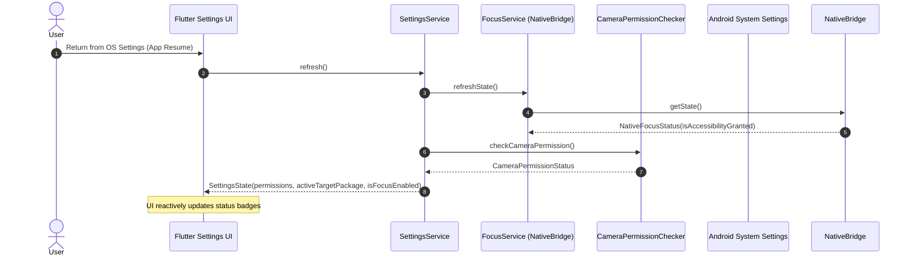

# LevelUp — Module 08: Settings & Permissions Engine Specification

**Document:** Settings & Permissions Engine Specification & Contract  
**Module ID:** `08` / `settingsEngine`  
**Status:** Implemented & Validated (Module 08.1 Audit Complete: 319/319 tests passing, zero analyzer issues, debug APKs compiled)  
**Branch:** `feature/core`  
**Primary Authors:** Senior Flutter Software Architect & Android Integration Engineer  

---

## 1. Overview & Responsibilities

Module 08 (`Settings & Permissions Engine`) provides a centralized, reactive application configuration and OS permission coordination engine for LevelUp. It bridges persistent user preferences, hardware sensor readiness (Camera), operating system accessibility services, and the voluntary Focus restriction gate.

### Core Responsibilities:
1. **Application Settings Management:** Loads, validates, updates, and resets typed user preferences (`AppSettings`).
2. **Permission Readiness & Lifecycle:** Authoritatively tracks and verifies Android Accessibility Service status and device Camera permission status (`PermissionsState`).
3. **External Change Detection:** Detects permission grants or external revocations when the user returns from Android OS Settings (`refresh()`).
4. **Focus & Gate Coordination:** Delegates restriction state changes and target app selection directly to `FocusService` (`Module 02`), preserving the Android Kotlin native gate as the single authority.
5. **Robust Local Persistence:** Safely persists user preferences into the existing SQLite database manager (`LevelUpDatabase`) using an isolated key-value table (`app_settings`), with deterministic fallback to defaults upon storage corruption or read failures.

---

## 2. Public Interfaces & Architecture

```
                               ┌────────────────────────────────────────────────────────┐
                               │                    ISettingsService                    │
                               │                   (SettingsService)                    │
                               └───────────┬───────────────────┬────────────────┬───────┘
                                           │                   │                │
                        ┌──────────────────▼───┐ ┌─────────────▼───┐ ┌──────────▼───────────────┐
                        │ ISettingsRepository  │ │  IFocusService  │ │ ICameraPermissionChecker │
                        │  (Sqlite / InMemory) │ │   (Module 02)   │ │    (Default / Mock)      │
                        └──────────┬───────────┘ └─────────────┬───┘ └──────────┬───────────────┘
                                   │                           │                │
                        ┌──────────▼───────────┐ ┌─────────────▼───┐ ┌──────────▼───────────────┐
                        │   LevelUpDatabase    │ │  NativeBridge   │ │   Camera Description /   │
                        │ (app_settings table) │ │   (Module 01)   │ │  OS Permission Prompt    │
                        └──────────────────────┘ └─────────────────┘ └──────────────────────────┘
```

### 2.1 `ISettingsService` Interface
```dart
abstract class ISettingsService {
  /// Latest cached snapshot of settings, permissions, and native synchronization.
  SettingsState get currentState;

  /// Broadcast stream of [SettingsState] transitions.
  Stream<SettingsState> get stateStream;

  /// Initializes the engine, loading persisted settings and querying hardware/OS permissions.
  Future<SettingsState> initialize();

  /// Authoritatively refreshes settings, native Focus state, and hardware permissions.
  Future<SettingsState> refresh();

  /// Updates application-level preferences, validating against domain invariants.
  Future<SettingsState> updateSettings(AppSettings newSettings);

  /// Updates the single application targeted for voluntary restriction.
  /// Delegates directly to [IFocusService.selectTargetApp] to preserve native gate authority.
  Future<SettingsState> setTargetApp(String packageName);

  /// Voluntarily activates or deactivates Focus restriction.
  /// Precondition: Requires verified Accessibility permission when enabling.
  Future<SettingsState> toggleFocus(bool enable);

  /// Dispatches the Android system intent to open Accessibility Settings.
  Future<bool> openAccessibilitySettings();

  /// Dispatches the Android system intent to open App Details Settings (Camera permissions).
  Future<bool> openAppSettings();

  /// Resets user preferences to factory defaults while preserving native gate target.
  Future<SettingsState> resetToDefaults();

  /// Disposes stream controllers and subscriptions.
  void dispose();
}
```

### 2.2 `ISettingsRepository` Interface
```dart
abstract class ISettingsRepository {
  Future<AppSettings> loadSettings();
  Future<void> saveSettings(AppSettings settings);
  Future<void> resetToDefaults();
}
```

### 2.3 `ICameraPermissionChecker` Interface
```dart
abstract class ICameraPermissionChecker {
  Future<CameraPermissionStatus> checkCameraPermission();
  Future<CameraPermissionStatus> requestCameraPermission();
}
```

---

## 3. Data Models

### 3.1 `AppSettings`
Typed, immutable representation of user preferences:
- `defaultTargetPackage`: `String` (must be in `ChannelConstants.allowedTargets`; defaults to `com.google.android.youtube`).
- `defaultUnlockDurationSeconds`: `int` (standard LevelUp invariant: `300` seconds / 5 minutes; fixed for MVP. Values other than `300` are rejected by validation to preserve challenge reward integrity).
- `emergencyPauseAllowed`: `bool` (non-negotiable safety invariant: emergency safe exit / return home cannot be disabled; defaults to `true`).
- `soundFeedbackEnabled`: `bool` (audio/countdown tick feedback toggle reserved for future UI feedback; defaults to `true`).
- `diagnosticLoggingEnabled`: `bool` (developer diagnostics logging toggle reserved for future debugging; defaults to `true`).

### 3.2 `CameraPermissionStatus`
Enum denoting camera availability:
- `granted`: Camera is accessible and usable for pose tracking.
- `denied`: User denied camera permission or not yet requested.
- `permanentlyDenied`: Denied with "Don't ask again" or blocked by OS settings.
- `restricted`: Blocked by parental controls or device policy.
- `unknown`: Status not yet determined.

### 3.3 `PermissionsState`
Immutable snapshot of required prerequisites:
- `isAccessibilityGranted`: `bool` (authoritatively queried from `INativeBridge.getState()`).
- `cameraStatus`: `CameraPermissionStatus`.
- `lastChecked`: `DateTime`.
- `isReadyForChallenges`: `bool` (`isAccessibilityGranted && cameraStatus == CameraPermissionStatus.granted`).
- `hasAnyMissingPermission`: `bool` (`!isReadyForChallenges`).

### 3.4 `SettingsState`
Combined state consumed by UI or Coordinators:
- `settings`: `AppSettings`.
- `permissions`: `PermissionsState`.
- `activeTargetPackage`: `String` (synced with native gate).
- `isFocusEnabled`: `bool` (synced with native gate).
- `isLoading`: `bool`.
- `errorMessage`: `String?`.

---

## 4. Persistence Architecture

User preferences are stored in the existing SQLite database managed by `LevelUpDatabase` (`levelup.db` in Real Device mode, `levelup_simulation.db` in Simulation mode) at database schema version `2`:

### SQLite Schema Migration (v1 -> v2)
- **Version 1 Schema:** Contained `workout_sessions` and `access_attempts` tables.
- **Version 2 Schema:** Includes `app_settings` key-value table:
```sql
CREATE TABLE IF NOT EXISTS app_settings (
  key TEXT PRIMARY KEY NOT NULL,
  value TEXT NOT NULL,
  updated_at INTEGER NOT NULL
);
```
- **Migration Logic (`onUpgrade`):** When migrating an existing database where `oldVersion < 2`, `LevelUpDatabase._onUpgrade` executes `CREATE TABLE IF NOT EXISTS app_settings` in a transaction. Existing workout sessions, access attempts, and indices are completely preserved without data loss or table recreation.
- **Clean Database (`onCreate`):** A brand new database creates all three tables (`workout_sessions`, `access_attempts`, and `app_settings`) immediately.

### Safety & Fault Tolerance Guarantees:
1. **Isolated Key-Value Store:** User preferences are isolated from workout and attempt history. Settings resets or corruption never erase `workout_sessions` or `access_attempts`.
2. **Auto-healing Fallback:** If the `app_settings` table contains corrupted JSON data or is unreadable, `SqliteSettingsRepository.loadSettings()` safely catches the error and falls back to deterministic defaults (`AppSettings.defaults()`).
3. **No Unnecessary Dependencies:** Operates using existing `sqflite` and `path` dependencies without pulling in third-party key-value storage packages.

---

## 5. Integration with Modules 01–07 & Coordinator

| Module | Interaction with Module 08 |
|---|---|
| **Module 01: Native Bridge** | SettingsService reads authoritative native gate state (`getState()`) and dispatches system intent requests (`openAccessibilitySettings()`). |
| **Module 02: Focus Engine** | SettingsService delegates `selectTargetApp` and `toggleFocus` directly to `FocusService`. The native Android gate remains the sole authority for target restriction. |
| **Module 03: Challenge Engine** | `defaultUnlockDurationSeconds` (300s) aligns with `ChallengeCatalog.squatUnlockChallenge`. |
| **Module 05: Session Manager** | Pre-challenge checks verify `isReadyForChallenges` before camera acquisition. |
| **Module 06: Access Engine** | Changing target app via `SettingsService.setTargetApp()` propagates to native gate, invalidating active access in accordance with existing security rules. |
| **Module 07: Local Database** | `SqliteSettingsRepository` shares the single `LevelUpDatabase` manager instance. |
| **Core Coordinator** | Coordinator relies on `FocusService` and `AccessService`; Settings provides high-level preference management for future UI tabs. |

---

## 6. Permissions Lifecycle & External Revocation



1. **Explicit Consent Invariant:** Permissions are never claimed granted unless verified by native Android APIs.
2. **External Revocation Detection:** When the user revokes Camera or Accessibility permissions in system settings, returning to the app calls `refresh()` via `didChangeAppLifecycleState`, immediately transitioning `isReadyForChallenges` to `false` and disarming Focus if accessibility was lost.
3. **Non-Destructive Exit:** Deactivating Focus is always permitted regardless of permission state.

---

## 7. Developer Lab Integration

1. **System Hub (Screen 1):** Module 08 appears as `'08 Settings & Permissions'` in the System Health grid.
2. **Preflight & Focus (Screen 2):** Connects with live permissions state.
3. **Test Center (Screen 6):** Contains 6 automated test scenarios and 1 physical manual checklist item:
   - `M08_PROBE_CURRENT_SETTINGS` (Real Device Probe)
   - `M08_ISOLATED_DEFAULT_INIT` (Isolated Scenario)
   - `M08_ISOLATED_CRUD_PERSISTENCE` (Isolated Scenario)
   - `M08_ISOLATED_INVALID_SETTINGS_REJECTION` (Isolated Scenario)
   - `M08_ISOLATED_STORAGE_FAILURE_RECOVERY` (Isolated Scenario)
   - `M08_ISOLATED_PERMISSION_REVOCATION` (Isolated Scenario)
   - `MANUAL_SETTINGS_NAVIGATION` (Manual Device Checklist)

---

## 8. How Future Final UI (`feature/ui`) Consumes Module 08

The teammate building the final 5-tab interface (`SettingsTab`) will consume `ISettingsService` as follows:

```dart
// Reading current preferences and permissions
final settingsService = context.read<ISettingsService>();
final state = settingsService.currentState;

// Stream builder for live updates
StreamBuilder<SettingsState>(
  stream: settingsService.stateStream,
  initialData: settingsService.currentState,
  builder: (context, snapshot) {
    final s = snapshot.data!;
    return Column(
      children: [
        SwitchListTile(
          title: const Text('Sound Feedback'),
          value: s.settings.soundFeedbackEnabled,
          onChanged: (val) => settingsService.updateSettings(
            s.settings.copyWith(soundFeedbackEnabled: val),
          ),
        ),
        ListTile(
          title: const Text('Camera Permission'),
          subtitle: Text(s.cameraStatus.label),
          trailing: s.isCameraGranted ? const Icon(Icons.check) : OutlinedButton(
            onPressed: settingsService.openAppSettings,
            child: const Text('Grant'),
          ),
        ),
      ],
    );
  },
);
```

---

## 9. Known Limitations & Hardware Items

1. **Native Camera Permission Probe:** Non-requesting camera permission status checks are performed directly via `checkSelfPermission(Manifest.permission.CAMERA)` over the `levelup_test/control` MethodChannel, avoiding false positives from hardware enumeration or premature OS permission dialogs.
2. **Direct Intent to App Details:** `openAppSettings()` dispatches `Settings.ACTION_APPLICATION_DETAILS_SETTINGS` with `package:com.levelup.levelup_test` intent directly to the Android OS application info settings.
3. **Physical Device Validation:** Verification of physical camera permission toggle and OS settings return requires connected hardware (Google Pixel 7 Pro).
